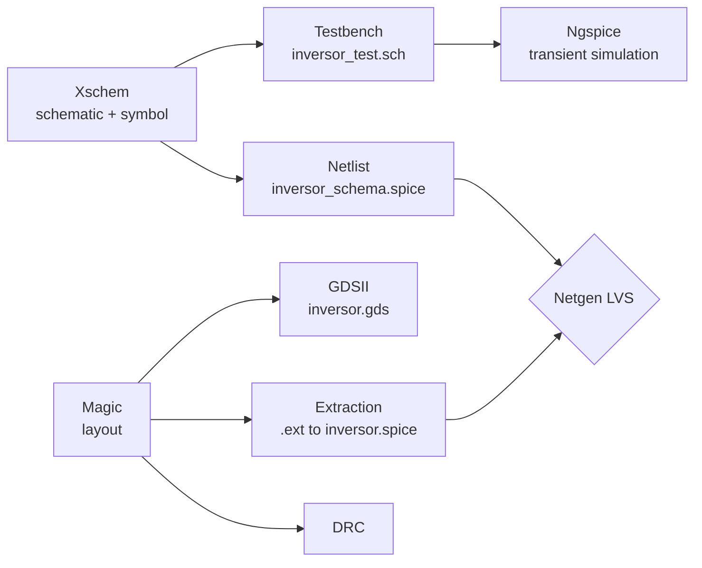

# CMOS Inverter on SkyWater SKY130: Open-Source Analog Design Flow

Complete analog IC design flow for a CMOS inverter in the open-source **SkyWater SKY130** process, from schematic capture to physical layout and verification, using only open-source EDA tools. Developed for the *Electronic Devices* course (TP5, "Analog Design Flow with CMOS") at **UTN FRC, Córdoba, Argentina** (Group 07, 2026).

| Item | Value |
|---|---|
| Technology | SkyWater SKY130 (`sky130B` variant), 1.8 V core devices |
| Supply | V<sub>DD</sub> = 1.8 V |
| Tools | Xschem, Ngspice, Magic VLSI, Netgen |
| Environment | Debian Linux (VirtualBox VM) |

## Design flow



### 1. Schematic capture (Xschem)
The inverter is a single pull-up PMOS and pull-down NMOS pair using the SKY130 primitive devices. A custom symbol (`inversor.sym`) with pins `Vdd`, `Vin`, `Vout`, `Vss` lets the cell be instantiated in a testbench.

| Device | Model | W (µm) | L (µm) | Finger count |
|---|---|---|---|---|
| M1 (pull-up) | `sky130_fd_pr__pfet_01v8` | 2.1 | 0.15 | 1 |
| M2 (pull-down) | `sky130_fd_pr__nfet_01v8` | 1.05 | 0.15 | 1 |

The PMOS is sized 2:1 relative to the NMOS to partially compensate for the lower hole mobility.

### 2. Pre-layout simulation (Ngspice)
The testbench `xschem/inversor_test.sch` instantiates the inverter with:

- Supply: 1.8 V DC
- Input: pulse 0 to 1.8 V, 1 ns rise/fall, 5 ns width, 10 ns period
- Load: `res_iso_pw` resistor (W = L = 2.65 µm) to ground
- Corner: `tt`
- Analysis: transient, 0.1 ns step, 40 ns stop time (`.control` block saves `inversor_test.raw`)

<!-- TODO: add the transient waveform (in/out) as results/transient.png and the measured values below. -->

| Metric | Value |
|---|---|
| t<sub>pHL</sub> | TODO |
| t<sub>pLH</sub> | TODO |
| Output swing | TODO |

### 3. Physical layout (Magic)
The layout (`magic/inversor.mag`) is drawn in the `sky130B` technology using the PDK parametrized cells for both transistors, routed in metal 1, with labeled ports `Vdd`, `Vout`, `Vin`, `Vss`.

- **DRC:** 0 violations in Magic.

<!-- TODO: add a layout screenshot as results/layout.png -->

### 4. Extraction and netlist export
Parasitics and devices are extracted from the layout (`magic/inversor.ext`) and exported to SPICE as `spice/inversor.spice`. The schematic-side netlist is `spice/inversor_schema.spice`.

### 5. Layout vs. Schematic (Netgen)
`netgen/comp.out` contains the Netgen LVS report comparing the extracted layout netlist against the schematic netlist.

### 6. GDSII export
The layout is exported to `gds/inversor.gds` (top cell `inversor`, with the PMOS and NMOS parametrized cells as sub-cells).

## Current status and known issues

| Stage | Status |
|---|---|
| Schematic + symbol | Done |
| Testbench / transient simulation | Testbench configured; results to be added |
| Layout + DRC | Done, 0 DRC violations |
| Extraction | Done |
| LVS | **Not yet clean** (see below) |
| GDSII export | Done (exported before LVS was clean) |

**LVS result (`netgen/comp.out`):** the device and net counts match (2 devices, 4 nets) but Netgen reports *"Netlists do not match"* and *"Top level cell failed pin matching"*. In the extracted layout netlist, the four port labels (`Vdd`, `Vout`, `Vin`, `Vss`) are not electrically connected to any transistor terminal, the source and drain of each transistor end up on the same net, and the N-well and substrate nodes are floating. This points to missing metal/contact connections between the transistor terminals and the port rectangles, plus missing well/substrate taps.

Next steps: fix the routing and add well/substrate taps in Magic, re-extract, re-run LVS until it reports that the circuits match, then re-export the GDSII and update this table.

## Repository structure

```
.
├── xschem/
│   ├── inversor.sch          # inverter schematic
│   ├── inversor.sym          # inverter symbol
│   └── inversor_test.sch     # transient testbench
├── spice/
│   ├── inversor_schema.spice # netlist from the schematic
│   └── inversor.spice        # netlist extracted from the layout
├── magic/
│   ├── inversor.mag          # layout
│   └── inversor.ext          # extraction output
├── netgen/
│   └── comp.out              # LVS comparison report
├── gds/
│   └── inversor.gds          # GDSII stream
└── results/                  # plots and screenshots
```

## How to reproduce

### Prerequisites
Xschem, Ngspice, Magic and Netgen installed, plus the SKY130 PDK (for example via [open_pdks](https://github.com/RTimothyEdwards/open_pdks)). Set the PDK location:

```bash
export PDK_ROOT=/usr/local/share/pdk   # adjust to your install
export PDK=sky130B
```

The PDK is **not** included in this repository.

### Schematic and simulation
```bash
cd xschem
xschem --rcfile $PDK_ROOT/$PDK/libs.tech/xschem/xschemrc inversor_test.sch
```
In Xschem: *Netlist*, then *Simulate* (Ngspice). The waveform is written to `inversor_test.raw` (ignored by git).

### Layout, DRC and extraction
```bash
cd magic
magic -rcfile $PDK_ROOT/$PDK/libs.tech/magic/${PDK}.magicrc inversor.mag
```
In the Magic console:
```tcl
drc check
drc count
extract all
ext2spice lvs
ext2spice
gds write inversor.gds
```

### LVS
```bash
netgen -batch lvs "spice/inversor.spice inversor" "spice/inversor_schema.spice inversor" \
  $PDK_ROOT/$PDK/libs.tech/netgen/${PDK}_setup.tcl netgen/comp.out
```

## Authors
- Tomas Posleman

## License

<!-- TODO: choose a license (MIT is a common choice) and add a LICENSE file. -->
